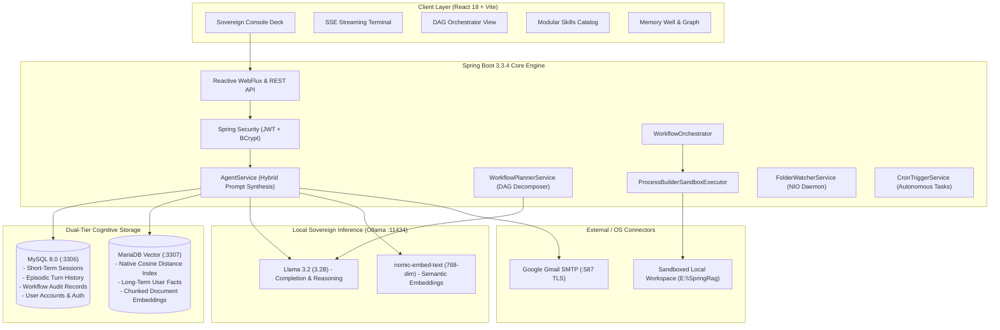

# ⚔️ RAGNAROK: Sovereign Local AI Agent & Autonomous Command Deck

[](https://spring.io/projects/spring-boot)
[](https://spring.io/projects/spring-ai)
[](https://ollama.ai)
[](https://mariadb.com)
[](https://mysql.com)
[](https://react.dev)
[](https://vitejs.dev)
[](LICENSE)

**Ragnarok** is an enterprise-grade, sovereign personal AI agent engineered for 100% private, local inference and persistent cognitive recall. Built with a dual-storage memory architecture (**MySQL** short-term buffer + **MariaDB Vector** semantic memory) and orchestrated by **Spring AI** with **Ollama (Llama 3.2)**, Ragnarok combines conversational intelligence with autonomous multi-step DAG workflows, sandboxed workspace execution skills, authentic Gmail SMTP dispatch, and background proactivity.

---

## 🏛️ System Architecture



---

## 🚀 Key Features

### 1. 💬 Real-Time SSE Streaming Chat & Interactive Console
- **Ultra-Fast Streaming**: Reactive SSE (`text/event-stream`) streaming using Spring WebFlux, rendering tokens dynamically with typing feedback.
- **Immediate Response Time**: Streamlined prompt synthesis and optimized CPU thread allocation (8 performance threads) delivering a **Time to First Token (TTFT) of ~1.2s**.
- **Interactive Staging**: Automatically extracts staged artifacts (such as email drafts and tool plans) and renders interactive action cards directly inside chat bubbles.

### 2. 🧠 Dual-Tier Cognitive Memory Well
- **Short-Term Conversational Buffer (MySQL :3306)**:
  - Tracks individual chat sessions with automatic title generation based on conversational context.
  - Preserves recent conversation turns for continuous dialog flow.
- **Long-Term Semantic Memory (MariaDB Vector :3307)**:
  - Native vector store using `COSINE_DISTANCE` metric over 768-dimensional embeddings generated by `nomic-embed-text`.
  - Persists permanent user facts, instructions, profiles, and preferences.
- **Memory Consolidation & Pruning**:
  - Automatically summarizes and consolidates short-term session messages into high-density vector facts.
  - Prunes expired interaction logs older than 30 days to maintain peak database performance.
- **Muninn’s Saga-Log (Episodic History)**:
  - Immutable chronological audit trail of all agent interactions with keyword search and metadata tracking.

### 3. ⚡ Autonomous DAG Workflow Orchestration
- **Goal Decomposition**: Translates natural language directives into multi-step Directed Acyclic Graphs (DAGs).
- **Dependency Resolution**: Steps define explicit prerequisites (`dependsOn`) and execute sequentially or concurrently.
- **Self-Healing & Auto-Retry**: Built-in retry mechanisms for failed nodes with execution state tracking (`PENDING`, `RUNNING`, `COMPLETED`, `FAILED`).
- **Audit History**: Every workflow execution persists its goal, steps, execution logs, and timestamps.

### 4. 🛠️ Sandboxed Workspace Skills & Tools
Ragnarok provides sandboxed access to local workspace tools under strictly enforced root boundaries:
- `file_read`: Safely reads UTF-8 text or source code files within the workspace.
- `file_write`: Creates or overwrites code, reports, or data artifacts.
- `file_search`: Recursively searches files using pattern or regex matching.
- `shell_command`: Runs approved PowerShell/cmd commands inside an isolated ProcessBuilder with execution timeouts and output capturing.
- `knowledge_search`: Performs vector similarity retrieval against MariaDB memory.
- `email_send`: Dispatches notifications via SMTP.
- `http_webhook`: Calls external webhooks with JSON payloads.

### 5. 📧 Gmail SMTP Dispatcher & Human-in-the-Loop Safeguards
- **Real SMTP Delivery**: Connected to Google Gmail SMTP (`smtp.gmail.com:587` with TLS authentication).
- **Autonomous Drafting**: Generates structured `email-draft` blocks whenever user requests email creation.
- **Zero Hallucination Gating**: Strict enforcement ensures the agent **never sends an email without explicit human confirmation** (via interactive UI button or affirmative conversational reply: *"Yes / Send it"*).

### 6. 📚 Document Ingestion & Vector Graph
- **Multi-Format Support**: Ingests `.txt`, `.md`, and `.pdf` files.
- **Intelligent Chunking**: Uses Spring AI’s `TokenTextSplitter` (800 token chunks with 100 token overlap).
- **Instant Indexing**: Chunks are embedded and stored in MariaDB Vector for zero-shot RAG retrieval.
- **Folder Watcher Daemon**: Java NIO `WatchService` monitors `watch_folder/` to automatically ingest new files placed in the directory.

### 7. 🧭 Contextual Proactivity Engine
- **Autonomous Context Sweeping**: Analyzes long-term semantic memory to discover pending deadlines, commitments, or project goals.
- **Actionable Suggestion Cards**: Generates cards in the UI with one-click actions:
  - **Accept & Run**: Automatically passes the prepared prompt to the agent chat.
  - **Dismiss**: Clears the card from the active queue.

### 8. 🔒 Sovereign Security & Authentication
- **JWT Authentication**: Stateless HS512 token-based authentication with expiration handling.
- **Role-Based Access Control**: `ROLE_ADMIN` (root/owner access) and `ROLE_USER` permissions.
- **Password Protection**: BCrypt hashing with salt.

---

## 💻 Tech Stack & Ports

| Component | Technology | Port / URI | Description |
|---|---|---|---|
| **Backend Service** | Spring Boot 3.3.4, Java 21/25 | `http://localhost:8080` | Core agent REST & SSE API |
| **Frontend Deck** | React 18, Vite 6, Vanilla CSS | `http://localhost:5173` | Cyberpunk Sovereign Console UI |
| **Short-Term Storage** | MySQL 8.0 | `localhost:3306` | Relational buffer & session state |
| **Vector Database** | MariaDB Vector 11.4 | `localhost:3307` | Native Cosine Distance Vector Index |
| **Inference Engine** | Local Ollama | `http://localhost:11434` | `llama3.2` (3.2B) & `nomic-embed-text` |
| **Email Gateway** | Gmail SMTP | `smtp.gmail.com:587` | TLS-encrypted email delivery |

---

## 📁 Repository Structure

```
SpringRag/
├── docker-compose.yml              # MariaDB Vector container definition (Port 3307)
├── pom.xml                         # Maven dependencies & build lifecycle
├── sample_notes.txt                # Sample workspace test document
├── watch_folder/                   # Directory monitored by FolderWatcherService
│
├── src/main/java/com/ragnarok/
│   ├── RagnarokApplication.java    # Application entry point (@EnableScheduling, @EnableAsync)
│   ├── config/                     # Configuration beans (Cors, JPA, Ollama, MariaDB Vector)
│   ├── controller/                 # REST & SSE Controllers (Chat, Auth, Memory, Skills, etc.)
│   ├── dto/                        # Data Transfer Objects (Chat, Email, Workflow, Auth)
│   ├── entity/                     # JPA Entities (ChatMessageRecord, SuggestionCard, UserAccount)
│   ├── repository/                 # Spring Data JPA Repositories
│   ├── sandbox/                    # ProcessBuilderSandboxExecutor (Boundary enforcement)
│   ├── security/                   # Spring Security filter chain, JWT service & handlers
│   ├── service/                    # Business logic (AgentService, Memory, Workflows, SMTP)
│   └── skill/                      # Modular Skill definitions & SkillRegistry
│       └── builtin/                # Built-in skills (FileRead, FileWrite, ShellCommand, etc.)
│
├── src/main/resources/
│   └── application.properties      # Database connections, Ollama options, SMTP settings
│
├── frontend/                       # Active React 18 + Vite frontend
│   ├── index.html                  # HTML5 entry with responsive meta tags
│   ├── package.json                # Frontend dependencies (Lucide-react, Vite)
│   ├── vite.config.js              # Vite server configuration
│   └── src/
│       ├── App.jsx                 # View state machine (Landing -> Auth -> Dashboard)
│       ├── App.css                 # Fixed chrome/sidebar & scrollable deck layout system
│       ├── index.css               # Design tokens, typography, custom scrollbars
│       ├── api.js                  # SSE stream parser & authenticated fetch client
│       └── components/             # UI components
│           ├── Dashboard.jsx       # Sovereign Command Deck (Overview, Chat, Memory, Tasks, Skills)
│           ├── Header.jsx          # Top fixed chrome bar with system status badges & logout
│           ├── Sidebar.jsx         # Left fixed navigation bar
│           ├── ChatArea.jsx        # Interactive message feed & stream input
│           ├── EmailDraftCard.jsx  # Interactive human-in-the-loop email confirmation
│           ├── EmailModal.jsx      # Manual SMTP email composer
│           ├── LandingPage.jsx     # Sovereign animated promotional landing page
│           └── AuthPage.jsx        # Login & registration portal
│
└── main_frontend/                  # Synchronized reference frontend workspace
```

---

## 🛠️ Prerequisites & Setup Guide

### 1. Prerequisites
- **Java 21 or Java 25** (JDK installed and configured on `PATH`)
- **Node.js 18+** & **npm**
- **Apache Maven 3.8+**
- **Docker Desktop** (for running MariaDB Vector)
- **Local MySQL Server** running on port `3306`
- **Ollama** installed locally ([ollama.ai](https://ollama.ai))

---

### 2. Step-by-Step Installation

#### Step 1: Pull Required Models in Ollama
Ensure Ollama is running, then pull both the chat model and the embedding model:
```bash
ollama pull llama3.2
ollama pull nomic-embed-text
```

#### Step 2: Start MariaDB Vector Container
Launch the official MariaDB Vector 11.4 container using Docker Compose:
```bash
docker compose up -d
```
*This starts MariaDB Vector on port `3307` with database `vectordb2`.*

#### Step 3: Configure MySQL Database
Ensure local MySQL is listening on port `3306`. Create the database if it doesn't already exist:
```sql
CREATE DATABASE IF NOT EXISTS SpringRagnarok;
```

#### Step 4: Configure Application Properties
Inspect `src/main/resources/application.properties` and verify your credentials:
```properties
# Primary MySQL (Port 3306)
spring.datasource.url=jdbc:mysql://localhost:3306/SpringRagnarok?createDatabaseIfNotExist=true&useSSL=false&allowPublicKeyRetrieval=true
spring.datasource.username=root
spring.datasource.password=YOUR_MYSQL_PASSWORD

# MariaDB Vector (Port 3307 via Docker)
spring.vector.datasource.url=jdbc:mariadb://localhost:3307/vectordb2?createDatabaseIfNotExist=true
spring.vector.datasource.username=root
spring.vector.datasource.password=root123

# Local Ollama Inference (Optimized for Multi-Core CPUs)
spring.ai.ollama.base-url=http://localhost:11434
spring.ai.ollama.chat.model=llama3.2
spring.ai.ollama.chat.options.num-thread=8
spring.ai.ollama.chat.options.num-ctx=2048
spring.ai.ollama.chat.options.num-predict=512

# Gmail SMTP Gateway
spring.mail.username=your-email@gmail.com
spring.mail.password=your-app-password
```

#### Step 5: Build and Run Spring Boot Backend
```bash
# Build the project
mvn clean compile

# Launch Spring Boot
mvn spring-boot:run
```
*The backend will boot up and bind to `http://localhost:8080`.*

#### Step 6: Launch Frontend
In a new terminal window:
```bash
cd frontend
npm install
npm run dev
```
*Access the Sovereign Command Deck at `http://localhost:5173`.*

---

## 📡 API Reference Overview

### 🔐 Authentication (`/api/auth`)
| Method | Endpoint | Description |
|---|---|---|
| `POST` | `/api/auth/register` | Register a new user (`email`, `password`, `fullName`, `role`) |
| `POST` | `/api/auth/login` | Authenticate and obtain JWT Bearer Token |
| `GET` | `/api/auth/me` | Retrieve profile of authenticated user |
| `POST` | `/api/auth/logout` | Terminate active user token context |

### 💬 Chat & Streaming (`/api/chat`)
| Method | Endpoint | Description |
|---|---|---|
| `POST` | `/api/chat` | Synchronous prompt execution returning JSON response |
| `GET` | `/api/chat/stream` | Real-time SSE stream (`sessionId`, `message`, `token`) |
| `POST` | `/api/chat/stream` | Real-time SSE stream with JSON payload |

### 🧠 Cognitive Memory (`/api/memory`)
| Method | Endpoint | Description |
|---|---|---|
| `POST` | `/api/memory/remember` | Ingest explicit permanent memory fact into MariaDB Vector |
| `GET` | `/api/memory/session/{sessionId}` | Fetch short-term message buffer for session |
| `DELETE` | `/api/memory/session/{sessionId}` | Clear all short-term history for session |
| `GET` | `/api/memory/episodic` | Search chronological episodic saga-log |
| `POST` | `/api/memory/consolidate` | Trigger memory consolidation into vector facts |
| `POST` | `/api/memory/prune` | Prune messages older than 30 days |

### ⚡ Workflows & DAG Orchestration (`/api/workflows`)
| Method | Endpoint | Description |
|---|---|---|
| `POST` | `/api/workflows/plan` | Generate DAG execution plan from natural language goal |
| `POST` | `/api/workflows/execute` | Decompose and execute DAG task graph |
| `GET` | `/api/workflows/executions` | Fetch history of all workflow executions |
| `POST` | `/api/workflows/retry/{id}` | Retry a failed execution plan |

### 🛠️ Skills Catalog (`/api/skills`)
| Method | Endpoint | Description |
|---|---|---|
| `GET` | `/api/skills` | List all registered built-in and sandboxed skills |
| `POST` | `/api/skills/{skillName}/execute` | Manually test and execute a skill with JSON parameters |

### 📚 Knowledge Ingestion (`/api/knowledge`)
| Method | Endpoint | Description |
|---|---|---|
| `POST` | `/api/knowledge/upload` | Upload `.txt`, `.md`, or `.pdf` document for RAG vectorization |

### 📧 SMTP Dispatcher (`/api/email`)
| Method | Endpoint | Description |
|---|---|---|
| `POST` | `/api/email/send` | Directly dispatch email via Gmail SMTP |
| `POST` | `/api/email/confirm/{draftId}` | Confirm and send staged email draft |
| `POST` | `/api/email/cancel/{draftId}` | Cancel and discard staged email draft |

### 🧭 Proactive Intelligence (`/api/proactive`)
| Method | Endpoint | Description |
|---|---|---|
| `GET` | `/api/proactive/suggestions` | Fetch active pending proactive suggestions |
| `POST` | `/api/proactive/sweep` | Trigger on-demand contextual memory sweep |
| `POST` | `/api/proactive/suggestions/{id}/accept` | Accept and execute proactive suggestion |
| `POST` | `/api/proactive/suggestions/{id}/dismiss` | Dismiss proactive suggestion |

---

## 🎨 UI Layout & Design System

The Ragnarok frontend is built with a custom-engineered **Sovereign Dark Glassmorphism** design system:
- **Fixed Chrome Header**: Top bar stays permanently locked, displaying local core telemetry, server badges (`API: 8080`, `MySQL: 3306`, `Vector: 3307`, `Ollama 3.2`), current session indicator, and logout action.
- **Fixed Left Sidebar**: Pinned navigation deck featuring user avatar, role status, and navigation tabs with live badge counters.
- **Scrollable Inside Deck Window**: The main content window (`.console-main`) handles smooth independent vertical scrolling with slim custom cyan scrollbars, ensuring that headers, sidebars, and navigation never shift or scroll away.

---

## 📄 License

This project is licensed under the **MIT License**. Feel free to use, modify, and distribute it in sovereign, privacy-first environments.
